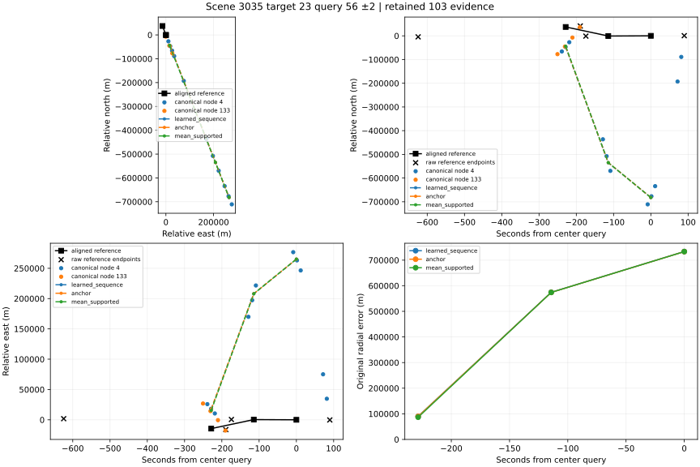
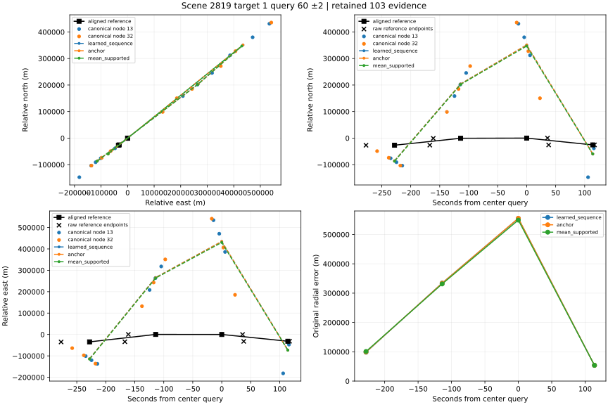
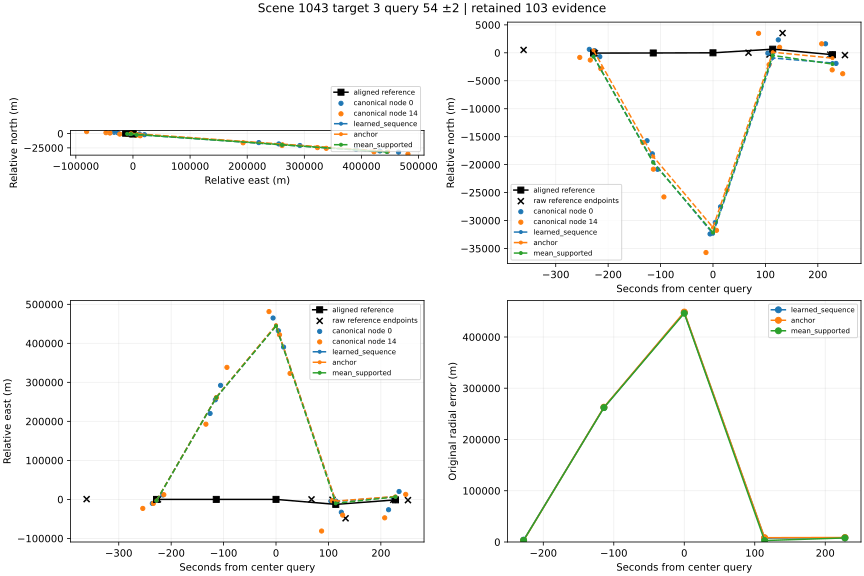

# 104 fixed-case chain audit

Positions/identities are withheld. Complete numeric evidence is in case JSON. Consistency is an implementation finding, not physical truth.

## Scene 3035, target 23, center query 56

Consistency: MATCHES_WITHIN_TOLERANCE; 0 mismatches. Plot: MISSING_DEPENDENCY: ModuleNotFoundError.

| query | reference kind / gap s / alpha | node | support | nearest native Δt s | native vs own-time ref m | query vs bound ref m | 090C m |
|---|---|---|---|---|---|---|---|
| 54 | interior / 435 / 0.910016 | 4 | True | 0.338143 | 90613.3 | 89921.6 | 90198.9 |
| 54 | interior / 435 / 0.910016 | 133 | True | 1.98714 | 87310 | 83487.5 | 90198.9 |
| 55 | interior / 264 / 0.227633 | 4 | True | 4.40524 | 544523 | 574002 | 574391 |
| 55 | interior / 264 / 0.227633 | 133 | False | 76.0952 | 5144.22 | 41581.6 | 574391 |
| 56 | interior / 264 / 0.660354 | 4 | True | 1.54267 | 727661 | 733309 | 733528 |
| 56 | interior / 264 / 0.660354 | 133 | False | 190.333 | 5144.22 | 40964.8 | 733528 |
| 57 | outside_support / unavailable / unavailable | 4 | False | 32.5714 | 96143.6 | unavailable | unavailable |
| 57 | outside_support / unavailable / unavailable | 133 | False | 304.571 | 5144.22 | unavailable | unavailable |
| 58 | outside_support / unavailable / unavailable | 4 | False | 146.81 | 96143.6 | unavailable | unavailable |
| 58 | outside_support / unavailable / unavailable | 133 | False | 418.81 | 5144.22 | unavailable | unavailable |

## Scene 2819, target 1, center query 60

Consistency: MATCHES_WITHIN_TOLERANCE; 0 mismatches. Plot: MISSING_DEPENDENCY: ModuleNotFoundError.

| query | reference kind / gap s / alpha | node | support | nearest native Δt s | native vs own-time ref m | query vs bound ref m | 090C m |
|---|---|---|---|---|---|---|---|
| 58 | interior / 110 / 0.446898 | 13 | True | 3.35027 | 107361 | 99152.2 | 98525.2 |
| 58 | interior / 110 / 0.446898 | 32 | True | 9.93473 | 78628.4 | 102962 | 98525.2 |
| 59 | interior / 197 / 0.239223 | 13 | True | 0.458984 | 330821 | 334002 | 334277 |
| 59 | interior / 197 / 0.239223 | 32 | True | 3.54498 | 304587 | 328855 | 334277 |
| 60 | interior / 197 / 0.817742 | 13 | True | 4.26824 | 601060 | 555269 | 554960 |
| 60 | interior / 197 / 0.817742 | 32 | True | 2.84476 | 518878 | 543083 | 554960 |
| 61 | interior / 79 / 0.962829 | 13 | True | 1.93651 | 20340.7 | 53842.9 | 53711.8 |
| 61 | interior / 79 / 0.962829 | 32 | False | 91.0635 | 238013 | 282421 | 53711.8 |
| 62 | outside_support / unavailable / unavailable | 13 | False | 112.032 | 20340.7 | unavailable | unavailable |
| 62 | outside_support / unavailable / unavailable | 32 | False | 205.032 | 238013 | unavailable | unavailable |

## Scene 1043, target 3, center query 54

Consistency: MATCHES_WITHIN_TOLERANCE; 0 mismatches. Plot: MISSING_DEPENDENCY: ModuleNotFoundError.

| query | reference kind / gap s / alpha | node | support | nearest native Δt s | native vs own-time ref m | query vs bound ref m | 090C m |
|---|---|---|---|---|---|---|---|
| 52 | interior / 136 / 0.980509 | 0 | True | 2.01779 | 1020.72 | 2853.82 | 3639.08 |
| 52 | interior / 136 / 0.980509 | 14 | True | 6.13221 | 10417.4 | 3860.08 | 3639.08 |
| 53 | interior / 293 / 0.379923 | 0 | True | 1.79346 | 256416 | 263069 | 262344 |
| 53 | interior / 293 / 0.379923 | 14 | True | 0.28154 | 262301 | 261340 | 262344 |
| 54 | interior / 293 / 0.768893 | 0 | True | 4.41029 | 434169 | 448653 | 447617 |
| 54 | interior / 293 / 0.768893 | 14 | True | 6.69529 | 423960 | 443927 | 447617 |
| 55 | interior / 25 / 0.250159 | 0 | True | 0.600032 | 9553.44 | 8409.07 | 7578.63 |
| 55 | interior / 25 / 0.250159 | 14 | True | 6.95497 | 2264.69 | 3607.8 | 7578.63 |
| 56 | interior / 28 / 0.150794 | 0 | True | 3.21122 | 2647.41 | 8760.32 | 8228.92 |
| 56 | interior / 28 / 0.150794 | 14 | True | 0.540222 | 7054.49 | 7263.79 | 8228.92 |

## Limits

- Measurements retained by 103 are canonical native observations, not untouched CSV rows.
- Measurement CSV to canonical processing cannot be independently reconstructed here.
- Original labels and reference may themselves be wrong; consistent replay does not establish truth.
- Three cases were selected after seeing tails; neighbors are fixed by index, not by error.
- No new predictor, calibration, matching, threshold or performance claim is produced.
- Method prediction vectors come from 103 public evidence; no independent model/NPZ replay.
