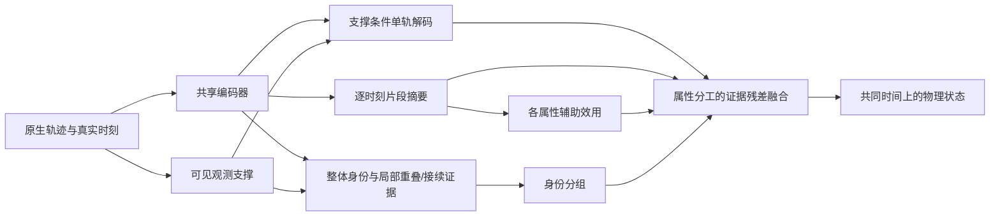

# 三阶段方法再设计：观测支撑、局部关联证据与属性分工融合

2026-10-18；**研究方案，尚未实现、没有新增GPU授权、不是READY交接。** 使用research-workflow，增量复用已有Mode C、来源分析和015/016实验复核，补核GRU-D、SUSHI及多任务注意力机制。017/018按原配置继续；本方案不替换正在执行的任务。用户最新要求是三个阶段都做具体精进，尤其融合不能仅保留原方案。

**后续实证更新（保留本方案原设计时序）：** 018已完成并经[本地复核](../../results/cooperative018_local_review/README.md)，基础恢复和身份仍不足，效用未呈稳定专属收益；017进入TFM、尚无完整终评。本文新结构未实现，018结果不能作为它的有效性证据。

**推荐一套连贯的小改动：补全显式感知观测支撑，关联增加局部重叠/接续证据，融合把四属性共用一个权重改成属性专属的信息路由。** 保留共享编码器与解码器，不叠加三套大网络。成熟机制加任务化改造可以作为候选贡献；本轮不以证明“海上首次”为开跑前置，也不把尚无实验的设计称为已有效。

## 1. 证据起点，以及纠正上一版说法

标记：DE＝原件/代码直接可核，SC＝来源主张，AI＝分析与设计推断，UN＝未知。本文的所有新方法收益都是AI/UN。

| 证据 | 已核事实 | 不能推出什么 |
| --- | --- | --- |
| E1：`association/cooperative.py:encode/score_pairs` | 当前候选关联只读原生观测memory的池化及时间支撑；018固定s0，不读物理补全轨迹 | 不能把015低分归因为“补全幻觉进入了关联” |
| E2：同文件`decode_group/_query_support` | decoder查询只有时间编码；距首尾等支撑特征在身份/效用小头使用，没有直接进入decoder查询 | 新增支撑查询有明确实现差异，但现代码可能已通过attention隐式学到它，收益未知 |
| E3：同文件`utility/_route_weights` | 已有逐query、双向、四属性效用；随后`mean(-1)`压成一个辅助权重，四个输出共用该路由 | 不能说还没有属性效用头；也不能仅据平均操作认定它造成速度退化 |
| E4：[015/016复核](../../results/cooperative016_local_review/README.md) | 两步短训oracle位置：utility比plain MAE低14.31%，速度MAE却高17.09%；正确分组仍有大误差 | 值得检验属性冲突，但训练不足、输出尺度/损失、教师效用不准仍是竞争解释 |
| E5：017本轮中期原件 | TCM100+TAM80；V macro-F1在TAM20为0.409805，其后40/60/80为0.391374/0.396349/0.397284；TFM尚未进入 | 不是完整流程成绩，不证明新方法必要或有效；不与旧TSA直接排名 |

E5来自`HandOver/results/TMTAFF-TIME-DEVELOPMENT-20261018-017/interim/{run,history,coverage}.json`。原件所有数值有限，未见必须停止的硬错误。018已回传22:36:10启动记录、独立run018实际命令/配置与GPU1选卡原件；服务器文字报告teacher已完成28步、S=360，run/history原件尚未回传，不把该文字当独立训练效果证据。新方案研究不干扰两轮。

## 2. 借鉴来源与适配关系

| 来源／本轮阅读范围 | 借用的核心思想 | 我们的A→A′改造 |
| --- | --- | --- |
| [GRU-D作者稿v2](https://arxiv.org/pdf/1606.01865)，§2、§2.1；出版方Methods局部核验 | 缺测标记与距观测的时间间隔作为显式输入。直接拼接是GRU-Simple；GRU-D还含衰减机制 | 改成离线航迹查询左右两侧的观测距离与存在标记，送入Transformer物理查询；不移植医疗变量回归总体均值的衰减假设 |
| [CroCo](https://arxiv.org/html/2210.10716v1)，复用§3 Eq1–2、附录C.2 | 从目标可见内容与辅助视图恢复被遮内容 | 已适配为真实时间、首尾连续留出、物理四状态；本轮在此基础增加支撑条件，不重复算已实现部分 |
| [SUSHI](https://arxiv.org/html/2212.03038)，§4.2、附录A.1 | 全局描述之外，最近端点、时间差和运动线索参与轨迹连接 | 同时覆盖海上跨源重叠与断段续接；保留全部候选，用真实局部token与端点作轻量证据，不搬视觉外观、图层级或非重叠边排除规则 |
| [Gekko](https://arxiv.org/html/2609.01530v1)，复用§3–4 Eq3/8及已有官方代码分析 | self/cross恢复误差比较与停止梯度的增益监督 | 已改为动态、方向性、逐query的物理属性效用；不以效用代替身份，不在推理读取reference |
| [MMoE作者页](https://research.google/pubs/modeling-task-relationships-in-multi-task-learning-with-multi-gate-mixture-of-experts/)，官方摘要；[MTAN作者稿](https://arxiv.org/pdf/1803.10704)，§3.1–3.2 Eq1–2局部方法 | 共享表征，同时允许各任务选择不同的信息 | 把任务改为物理属性，把可选信息改为原生辅助轨迹的查询摘要；属性效用决定来源路由。没有复制MMoE专家库或MTAN多层图像mask，称机制借鉴 |

MMoE摘要只支持共享专家/任务专属门控的架构判断，不冒称完整公式或实验复现。MTAN是共享表征与任务专属注意力的另一来源，不是MMoE到海上迁移成功的证据。Nature网页定点访问有失败，GRU机制以可读作者稿补核；不将出版式号套到作者稿。

海上近邻仍须诚实区分：[Traj-PathFormer作者记录](https://github.com/YongshuoLiu/Traj-PathFormer)已有跨源补全、时间查询、局部门控与物理预测；[PTFM](https://doi.org/10.3390/electronics14173461)已有已关联输入的物理融合、门控和残差。**我们的候选差异是异步缺段条件下，身份、时刻支撑和各属性恢复效用的具体分工，不能把“有注意力/有门控/有残差”当作海上首次。** 本轮是有限方法核验，不是新一轮穷尽检索。

## 3. 补全：同一时刻，根据观测支撑形成不同查询

当前query只有`PE(t)`。建议加入五维可见条件：距左/右最近真实点的距离、左/右点是否存在、是否位于原生首尾范围内：

`q_i(t) = PE(t) + W_phi · [d_left/S, d_right/S, has_left, has_right, inside_span]`。

没有某侧观测时距离填0并保留存在标记；不能把它当零缺口。S沿训练侧合法尺度，V不重新拟合。只从当前可见原生点计算，人工留出端点后重算，不使用reference mask。inside_span不等于该时刻有真实观测，更不等于有reference。

物理loss、时间单位、输出时刻和主干沿用。无bias的5→128投影仅640参数（设计算术）。补全和后续锚定融合复用此查询；有右侧可见信息的当前任务是离线恢复，不称严格在线预测。

**可检验预测：** 同训练量下，首尾外推/短轨的恢复改善，同时保留完整人口。若原time-only已学到同等信息，新增投影无收益就删除。暂不再加风险预测头、扩散、GP或额外NLL来制造模块数量。

## 4. 关联：整体表征之外，区分重叠与接续证据

保留现身份头作为全局判断，增加共享小残差头：

`s'_ij = s_ij + g(local_evidence_ij, availability_ij)`，并以交换对称方式构造或汇总特征。

- **重叠片段：** 选少量真实时间最接近的跨片段token对，摘要局部特征差、实际时间差及覆盖；不把异步点冒充同时刻，不先强制插值出大量伪点。
- **接续片段：** 比较早段尾部与晚段首部的原生token、时间间隔和状态变化；不用硬恒速门限删除难例。仅有两点的短轨仍参与。
- 缺少局部证据给availability标记，保持全局分支；不把“没有重叠”判为不同船，不用辅助效用正负改身份标签。原候选、划分及阈值口径不变。

共享encoder一次计算，各对只做少量token摘要和小MLP；不逐对运行完整decoder。初版局部token数等实现参数尚未确定，不能把本文件当执行配置。图像一一匹配会与同船多片段冲突，因此不另加整场景Sinkhorn。

**可检验预测：** 完整V身份质量改善，重叠与非重叠正对没有靠删一类换取涨分；物理输出中的错并损害相应下降。全局充分训练若已解决问题，这条局部支路可能没有增益。

## 5. 融合：按属性选择辅助证据，新增改动是必选研究内容

用户明确要求融合也继续改进，故本版**不以“保留018现融合”作为终点**。推荐把四属性共用的标量门控改为“共享单轨解码＋属性专属辅助证据残差”。这是对多任务门控思想的任务化改造，而非增加四个decoder。

记`r_j(t)`为现有query-pooling得到的片段j在t处的原生memory摘要；`h_i(t)`为同一共享decoder仅从锚片段i生成的隐藏状态。每个组的锚仍按既有规则，不由真值挑选；以下求和仅含组内辅助片段j≠i。对四个属性k（纬度、经度、速度、航向）分别定义：

```
w_ij,k(t) = eps + (1-eps) * sigmoid(s'_ij) * clamp(u_i<-j,k(t), 0, 1)
c_i,k(t) = sum_j w_ij,k(t) * (r_j(t)-r_i(t)) / (1 + sum_j w_ij,k(t))
h_i,k(t) = h_i(t) + W_c * c_i,k(t)
raw_k(t) = state_projection_row_k(h_i,k(t))
```

`W_c`为一个所有属性共享、无bias的128×128投影，新增16,384参数，约现2,156,814参数的0.76%（设计估计，未实现实计）。四个属性用原状态投影的对应行，之后沿原有物理尺度、速度非负映射和航向wrap/圆周loss；不直接平均经纬度或跨0/360的角度。无helper时`c=0`，回到本模型单轨解码。首版保留原正数floor，**不同时增加硬拒绝机制或承诺低效用严格零影响**。

这个改动确实改变了融合的来源选择：同一辅助可对位置权重大、对速度权重小，不必先把四种效用平均。共同底座保留状态间共享信息；分别路由也可能使位置/速度/航向不够协调，不能承诺物理一致性定理。主干只一次self解码，摘要可复用；新增池化/投影不等于零耗时，尤其替代原group decoder后真实性能与速度均待测。

**必须避免的混杂与实现误读：**

1. 这不只是把`mean(-1)`删掉：旧多轨token解码改成self基底加属性证据汇聚。其结构改动本身可能有效，因此必须有相同新结构的“所有属性共用平均u”对照，参数、更新与其他处理完全相同。
2. 同容量普通learned gate使用相同证据摘要及输出分支，只换权重来源；若它已解释增益，不能独占归因效用监督。
3. **旧018教师的增益标签不自动适用于新融合器。** 后续新结构应先以普通融合训练同一teacher，再按其self/cross输出产生四属性增益，复用代码和流程，不冒充直接复用旧标签。教师到适配后student的漂移风险仍需评价。
4. 该结构没有MMoE的固定专家子网络库，辅助片段数也可变化。我们借其任务专属选择思想，构造基于身份和恢复收益的来源门控，不能称精确复现MMoE。
5. 当前只有“代码压缩四属性”和“短训出现位置/速度权衡”两条证据；平均门控是否是原因未证实。先比较，不为得到好成绩改速度单位、删尾部或改变评价。

零floor拒绝、DUSt3R式风险头、额外self/cross双完整解码等均留作后置备选，不进入本版最小方案。

## 6. 三阶段如何成为同一个方法



三阶段共用真实观测和时间支撑；补全与融合共用状态解码器，关联输出控制可加入融合的片段，效用决定各属性怎样利用它们。**不强迫补全预测先成为新的观测再喂给关联**；这是信息连接的选择，不是缺少完整三阶段。训练仍用原生身份及合法reference监督，不新增测试信息。

## 7. 最小验证顺序：一次完整比较，细分归因后置

本方案只有一个主假设C2：**观测支撑和属性效用不同，按证据条件分工比统一全轨表征、统一属性路由更适合异步缺段。** 不把三处改动预先说成三个独立已证创新。

| 比较 | 回答什么 | 执行安排 |
| --- | --- | --- |
| 017完整TMTAFF近似参考；018已有四臂 | 当前参考与候选是否能学起来；现效用机制有无初步增量 | 已批任务照常完成，不重跑准备 |
| 下一版完整候选 vs 同数据的可比候选对照 | 三处改动组合是否值得继续 | 后续批准实现后给具体训练配置和总预算；不能拿训练量不同的旧018直接归因结构 |
| 同新融合结构：scalar-u vs attribute-u；同容量learned gate | 属性分工和效用监督是否各有增量 | 可共享teacher/编码/初始化；随下一轮完整训练评价完成，不前置额外诊断轮次 |
| 去掉支撑查询、去掉局部关联证据 | 补全、关联的单独贡献 | 总体有信号后补，不先做2³排列组合 |

概念归因映射保留A（同期沿用018融合结构的对照）、A′（新self+摘要残差结构但共用标量权重）、A′+B（属性专属权重）；完整系统其他改动在这一机制比较中固定相同。A不是直接使用旧018 checkpoint或分数，不把A→A′与A′→A′+B的收益混写。017用于完整任务参照，优化器/loss/训练量不同，不能当作等预算结构消融。

报告重点看完整V预测分组下真实缺失区的位置RMSE与全人口覆盖；速度/圆周航向、关联P/R/F1及错并拆分一起报告。这是研究关注项，不改变017/018选模；未来新训练的选模规则仍待具体配置确定。机制比较固定同一身份组，再对照oracle组；沿现评价口径，不新增事后综合分或挑子集阈值。属性路由若只换来位置改善而速度继续明显恶化，不能宣布解决属性冲突。记录各属性权重/增益摘要与改善、恶化案例，随正式运行写出，不先开新GPU取证任务。

训练粒度/步数/loss权重/总预算此时未确定，GPU授权为0新增；不能借018的2小时运行新模型。控制组的确切批次与训练机会在实施配置中固定，多种子与论文扩展后置。单seed V结果仅支持开发决策，T_test封存。

## 8. 本轮交付与下一步

已完成来源定点核验、现代码核对、Mode C增量、条件迁移与一套三阶段方案；融合公式、参数估计与归因设计经独立复核，补清同期对照与选模边界。结构化交接见本地研究目录`docs/plans/2026-10-18_complete_method_design/revisit_workflow.json`和三份`revisit_*.md`笔记。没有新训练、没有改017/018执行代码、没有宣称融合改进已写好。

本版建议推进到具体实现规格讨论。剩余最关键未知是：018较充分训练后是否仍有属性权衡与身份问题，以及新结构的属性路由是否优于同结构标量/普通门控。新来源不要求全部精读或下载完才继续，也不要求为了“每阶段改进”再增加更多模块。

## 9. 与完整baseline的参数核算

用户追问整套方案是否比baseline增加很多参数。按017/018正式配置，在CPU仅构造模型并逐参数计数，不读数据、不前向或训练；[核算原件](parameter_audit.json)保存完整分模块数。

| 对象 | 参数数 | 说明 |
| --- | ---: | --- |
| 017完整TMTAFF近似参考 | 8,720,132 | 补全＋关联2,782,976；融合5,937,156。共享权重只计一次，冻结模块仍计入；训练loss另有4个参数 |
| 018当前候选完整实例 | 2,156,814 | 包括普通门控对照头与尚未启用的效用辅助身份头；为参考的24.73%，少75.27% |
| 018效用方法实际推理路径 | 2,105,929 | 排除不参与此路径的ordinary_gate、identity_with_utility；为参考的24.15% |
| 新方案当前可确定部分 | 2,173,838＋局部关联分支 | 在完整候选实例上增加640支撑query参数＋16,384融合投影；已知增量约0.79%，局部关联宽度未定，不能报完整精确总数 |

候选共享补全/融合encoder-decoder；参考另有TAM编码器、TFM双编码器/decoder及展开序列的两层FC，仅TFM两层FC已有3,154,048参数。这解释当前参数差异，不代表候选精度或训练成本已更优。017的FC宽度128属于已披露适配，不能将8,720,132冒称论文作者精确参数数。训练teacher副本、优化器状态及四臂不同checkpoint不累计成单个推理模型参数；其训练/显存费用仍须单列。新模型最终参数在接口固定与实现后重新核算。
