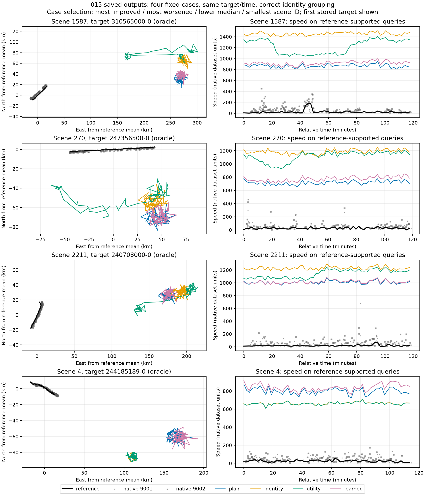

# 016 速度与固定案例：候选解码异常已确认，但不是017停训证据

本节只读016回传原件，不加载模型、不推理、不训练、不读取ZIP或T_test。全V速度结论来自服务器对256份已保存NPZ的CPU统计；本地独立逐点分析范围严格限定为4个预定场景、20个目标、四臂共16份NPZ。`speed_cases.py`可复算数值；`--plot`需可用matplotlib。临时绘图依赖位于`/tmp/mtad016-plot-libs`，未改项目环境或依赖文件。

## 速度：普遍预测过大，排除“输出接近零”的解释

Oracle分组的参考交集有18,364点，参考速度中位数19.076、均值28.906（全部使用数据原生速度单位，未擅自换算节或m/s）。四臂在完全相同点集上的结果：

| 臂 | 预测速度中位数/参考中位数 | 平均有符号误差（预测−参考） |
| --- | ---: | ---: |
| plain | 48.00 | +879.35 |
| identity | 60.85 | +1075.85 |
| utility | 57.10 | +1030.82 |
| learned | 49.46 | +905.88 |

全输出人口也一致异常：predicted每臂4,096个点、oracle每臂24,128个点全部>100，所有臂/分组最小值在252.4–496.1之间，无负值、近零或非有限值。因此015大速度误差的当前表现是**大正数偏差**，不是大量softplus负侧饱和到0。按照现有`softplus(raw)`实现，这一输出区间已经在正侧近似线性区域；不能据此推断训练时每一步、所有其他输入上的梯度均正常。

服务器文案“两侧分布无重叠区间”不成立。参考最大值9010.05，26/18,364个参考点>1000，范围与预测有交叠；准确描述是**所有预测都超过参考99分位138.73，主体分布严重偏离**。参考尾部仍原样保留，不能据本节就删异常值、换单位或改loss。

015 `run.json`给出了`error_scales[2]=415.2732`，但未返回模型的`state_mean`。014虽记录同一T_core装配的normalizer，也不能冒充015模型buffer的独立直接证据，因此本节不伪造“已从015权重逆推出z”的统计。现有代码确实包含`softplus(z * state_std + state_mean)`，大std能够放大未收敛z的偏移；但其因果贡献及应否改输出映射还需要明确的方案和验证，不把现象当成单一病因。

## 位置：案例主要为整体偏置，并非单纯错关联

保留原脚本选出的最大改善1587、最大恶化270、中位2211、最小编号4，没有新增有利筛选。每个场景的全部目标均参与JSON统计；图只按固定规则展示第一条存储目标，不按误差挑目标。统一使用真实身份oracle分组，确保同一目标、同一查询时刻、同一有效真值比较，而不是把混船的预测整轨硬配给多个真值。

| 场景 | 目标数 | utility位置MAE（km） | 每目标位置均方误差中整体偏置占比的中位数 |
| --- | ---: | ---: | ---: |
| 1587 | 3 | 194.81 | 96.01% |
| 270 | 8 | 167.57 | 96.00% |
| 2211 | 6 | 170.45 | 99.64% |
| 4 | 3 | 157.53 | 99.52% |

MAE使用与正式指标相同半径的haversine距离，4场景逐项重算与服务器共同点报告一致。偏置占比则是按每目标局部平面坐标，计算`||mean(pred−truth)||² / mean(||pred−truth||²)`，仅作几何诊断，不替换正式指标。

四案例20个目标中，utility有18个目标的该占比≥90%，其他三臂各19/20。说明这些案例大多是预测轨迹整体远离正确轨迹，而非只有个别末端补全点出错。图中不少输出聚在远处且只有小幅摆动，但有些目标出现几十公里漂移；不能统称“所有输出恒定”。场景270的第一目标是反例：utility偏置占比仅39.05%，动态形状误差也很大。四案例说明现象，不据此把比例推广为全部377目标。

原生9001/9002输入和reference都显示在图中，四臂输出均保留。图的速度纵轴使用原生单位；原始9002存在较大离散值，未过滤。图中效用臂位置某段更靠近reference，仍可能速度更差；“靠近一些”不等于已经恢复了目标运动。

## 与017的关系

这些数组来自**015候选CooperativeModel**。017是独立参考模型的新训练，且位置输出尺度已改成训练侧affine；参考速度头也不能直接等同候选`softplus(z*std+mean)`路径。016既没有017的预测数组，也没有证明017发生同样异常，因此**仅凭016不应中止017**。候选异常需要本线数值方案和更多训练验证；017应根据自身阶段loss、验证、预算和真实执行状态判断，而不是受另一模型的两步成本结果替代。
